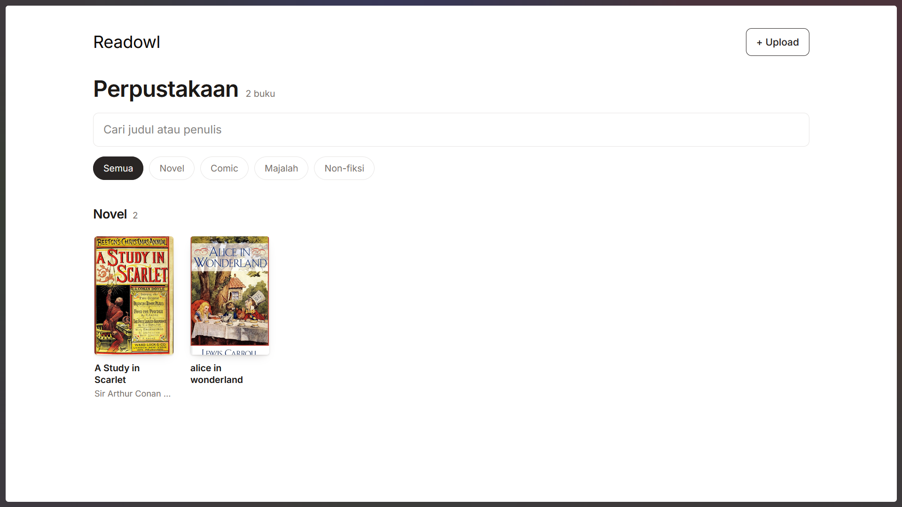

# 🦉 owl-read

<div align="center">


**Aplikasi perpustakaan digital yang tertata rapih dengan sistem rak buku dan pencarian cepat.**

</div>

---

## 📸 Preview

<div align="center">



*Dashboard utama*

</div>

---

## ✨ Fitur

- 📚 **Manajemen Rak Buku** — Buku tersusun rapih dalam rak-rak virtual
- 🔍 **Index Pencarian** — Cari buku dengan cepat berdasarkan judul, penulis, atau kategori
- 🎨 **UI Modern** — Antarmuka bersih dan responsif menggunakan Svelte
- ⚡ **Backend Cepat** — Dibangun dengan Go + framework Gin
- 🐳 **Docker Ready** — Multi-stage build, image ringan berbasis Alpine
- 💾 **Persistent Storage** — Data tersimpan di volume `./data`
- 🔒 **Non-root User** — Runtime berjalan sebagai user `app` (UID 1000)
- 🌐 **Reverse Proxy Ready** — Terintegrasi dengan network `caddy-net`

---

## 🏗️ Arsitektur

```
┌─────────────────────────────────────────────────────┐
│                    Caddy (Reverse Proxy)            │
└────────────────────────┬────────────────────────────┘
                         │ caddy-net
                         ▼
┌─────────────────────────────────────────────────────┐
│              Container: pustaka (:8080)             │
│  ┌───────────────────────────────────────────────┐  │
│  │  Go Backend (Gin)  +  Svelte Frontend (SSG)   │  │
│  └───────────────────────────────────────────────┘  │
└────────────────────────┬────────────────────────────┘
                         │ volume mount
                         ▼
                  ./data (database/)
                  ├── book/
                  └── cover/
```

### Multi-Stage Build

| Stage | Base Image | Tujuan |
|-------|-----------|--------|
| 1. Frontend Builder | `node:22-alpine` | Build Svelte → static files |
| 2. Backend Builder | `golang:1.27-alpine` | Compile Go binary (statically linked) |
| 3. Runtime | `alpine:3.20` | Image final minimal + non-root user |

---

## 📋 Prasyarat

- [Docker](https://docs.docker.com/get-docker/) v20.10+
- [Docker Compose](https://docs.docker.com/compose/) v2.0+
- Docker network bernama `caddy-net` (dibuat sekali saja)

---

## 🚀 Deployment

### 🐧 Debian / Ubuntu Based (apt)

#### 1. Install Docker & Docker Compose

```bash
# Update package list
sudo apt update

# Install dependensi dasar
sudo apt install -y ca-certificates curl gnupg lsb-release

# Tambahkan GPG key Docker
sudo mkdir -p /etc/apt/keyrings
curl -fsSL https://download.docker.com/linux/debian/gpg | \
  sudo gpg --dearmor -o /etc/apt/keyrings/docker.gpg

# Tambahkan repository Docker
echo "deb [arch=$(dpkg --print-architecture) signed-by=/etc/apt/keyrings/docker.gpg] \
https://download.docker.com/linux/debian $(lsb_release -cs) stable" | \
  sudo tee /etc/apt/sources.list.d/docker.list > /dev/null

# Install Docker Engine & Compose plugin
sudo apt update
sudo apt install -y docker-ce docker-ce-cli containerd.io docker-buildx-plugin docker-compose-plugin
```

> **Untuk Ubuntu**, ganti `debian` menjadi `ubuntu` pada URL dan repo di atas.

#### 2. Buat Docker Network

```bash
sudo docker network create caddy-net
```

#### 3. Clone & Deploy

```bash
git clone https://github.com/username/owl-read.git
cd owl-read

# Buat folder data
mkdir -p data/book data/cover

# Build & jalankan
sudo docker compose up -d --build
```

#### 4. Verifikasi

```bash
sudo docker compose ps
sudo docker compose logs -f pustaka
```

---

### 🎩 Red Hat / CentOS / Rocky / AlmaLinux Based (dnf/yum)

#### 1. Install Docker & Docker Compose

```bash
# Hapus podman-docker jika ada (untuk menghindari konflik)
sudo dnf remove -y podman-docker

# Install repo Docker CE
sudo dnf install -y dnf-plugins-core
sudo dnf config-manager --add-repo https://download.docker.com/linux/centos/docker-ce.repo

# Install Docker Engine & Compose plugin
sudo dnf install -y docker-ce docker-ce-cli containerd.io docker-buildx-plugin docker-compose-plugin

# Aktifkan & jalankan service Docker
sudo systemctl enable --now docker
```

> **Untuk Rocky Linux / AlmaLinux**, repo `centos` di atas tetap kompatibel.

#### 2. Buat Docker Network

```bash
sudo docker network create caddy-net
```

#### 3. Handle SELinux (khusus RHEL family)

Jika SELinux aktif (`getenforce` → `Enforcing`), tambahkan label `:Z` pada volume:

```yaml
volumes:
  - ./data:/app/database:Z
```

#### 4. Clone & Deploy

```bash
git clone https://github.com/username/owl-read.git
cd owl-read

mkdir -p data/book data/cover

sudo docker compose up -d --build

# Buka firewall jika perlu akses langsung
sudo firewall-cmd --permanent --add-port=8080/tcp
sudo firewall-cmd --reload
```

---

### 🪟 Windows (Docker Desktop)

#### 1. Install Docker Desktop

1. Download [Docker Desktop for Windows](https://www.docker.com/products/docker-desktop/)
2. Jalankan installer → centang **"Use WSL 2 instead of Hyper-V"** (disarankan)
3. Restart komputer
4. Buka **Docker Desktop** dan pastikan status **Engine running**

#### 2. Install WSL 2 (jika belum)

```powershell
wsl --install
wsl --set-default-version 2
```

#### 3. Buat Docker Network

Buka **PowerShell**:

```powershell
docker network create caddy-net
```

#### 4. Clone & Deploy

```powershell
git clone https://github.com/username/owl-read.git
cd owl-read

# Buat folder data
New-Item -ItemType Directory -Force -Path .\data\book, .\data\cover

# Build & jalankan
docker compose up -d --build

# Cek status
docker compose ps
docker compose logs -f pustaka
```

#### 5. Akses Aplikasi

Buka browser: **http://localhost:8080**

---

## 🔧 Konfigurasi

### `docker-compose.yml`

```yaml
services:
  pustaka:
    build:
      context: .
      dockerfile: Dockerfile
    container_name: pustaka
    restart: unless-stopped
    expose:
      - "8080"
    volumes:
      - ./data:/app/database
    environment:
      - PORT=8080
      - GIN_MODE=release
    networks:
      - caddy-net

networks:
  caddy-net:
    external: true
    name: caddy-net
```

### Environment Variables

| Variable | Default | Deskripsi |
|----------|---------|-----------|
| `PORT` | `8080` | Port HTTP server |
| `GIN_MODE` | `release` | Mode Gin (`debug` / `release`) |

### Volume

| Host | Container | Isi |
|------|-----------|-----|
| `./data` | `/app/database` | Database, file buku, dan cover |

---

## 🛠️ Development

### Build Lokal Tanpa Docker

```bash
# Backend
cd backend && go run ./cmd/server

# Frontend (terminal terpisah)
cd frontend && npm install && npm run dev
```

### Build Docker Image Manual

```bash
docker build -t owl-read:latest .
docker run -d -p 8080:8080 \
  -v $(pwd)/data:/app/database \
  -e GIN_MODE=release \
  owl-read:latest
```

### Perintah Berguna

```bash
# Lihat log realtime
docker compose logs -f pustaka

# Restart container
docker compose restart pustaka

# Rebuild setelah update kode
docker compose up -d --build

# Stop & hapus container (data tetap aman)
docker compose down

# Stop & hapus container + volume host
docker compose down && rm -rf ./data
```

---

## 🐛 Troubleshooting

| Masalah | Solusi |
|---------|--------|
| `network caddy-net not found` | Jalankan `docker network create caddy-net` |
| Permission denied pada `./data` | `sudo chown -R 1000:1000 ./data` |
| SELinux block (RHEL) | Tambahkan `:Z` pada volume di compose |
| Port 8080 sudah dipakai | Ubah env `PORT` atau gunakan reverse proxy |
| Frontend blank | Rebuild: `docker compose up -d --build --no-cache` |
| Build gagal di `npm ci` | Pastikan `frontend/package-lock.json` ada |

---

## 📂 Struktur Proyek

```
owl-read/
├── backend/              # Source code Go (Gin)
│   └── cmd/server/       # Entry point
├── frontend/             # Source code Svelte
│   ├── src/
│   └── package.json
├── vendor/               # Go vendored dependencies
├── data/                 # Volume (runtime)
│   ├── book/
│   └── cover/
├── img/
│   └── view.png          # Screenshot dashboard
├── Dockerfile            # Multi-stage build
├── docker-compose.yml
├── go.mod
├── go.sum
└── README.md
```

---

## 📄 Lisensi

Proyek ini dilisensikan di bawah **MIT License** — lihat file [LICENSE](LICENSE) untuk detail.

---

<div align="center">

**🦉 owl-read** — *Baca, cari cepat.*

Dibuat dengan ❤️, Go & Svelte

</div>